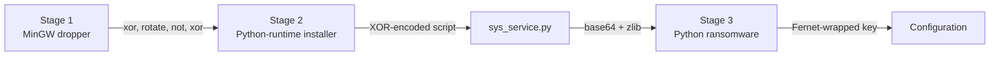

# Seven CRPx0 ransomware builds, unpacked statically: the key leaves in clear and much of the attack is broken

CRPx0 is a ransomware operation that appeared in mid-2026. In August the
Ransom-ISAC Research Team published a long analysis of several builds, and at
the end they listed seven files on MalwareBazaar they had not analysed,
calling them the best available independent test set for their detection
rules. I took those seven builds and unpacked them with static analysis only.
None of them ran on my machine.

- Reference sample: `28685dff00aa1752b62a8580955b2530d63092bdcc0528b872a668cddad78c11` (first seen 2026-08-04)
- Full technical report: [report.md](reports/crpx0/2026-10-15-28685dff00aa/report.md)

## Results

| | |
|---|---|
| Key handling | The victim's key is posted as JSON over plain HTTP to `hxxp://207.180.29[.]236:8080/relay[.]php` before any file is encrypted |
| Cryptography | Fernet (AES-128-CBC with HMAC) and RSA-4096; no exploitable weakness identified |
| What survives | Everything after the first 1 MiB of each file; deleted originals; possibly the shadow copies |
| Broken in these builds | Lateral movement, the anti-debug check, the AMSI patch; on 64-bit Windows the evasion layer gets truncated addresses |
| Builds | 7 builds for affiliate 21, made in 76 minutes on 2026-08-02 |
| Reproduced | Every layer rebuilt with Go and openssl: identical |

I did not resolve or contact any of the addresses in this write-up.

## The chain



1. Stage 1 is a small MinGW program with a 3.87 MB encrypted blob. Its
   decoder XORs each byte with one table, rotates it, inverts it and XORs it
   with a second table. It writes the result to `%LOCALAPPDATA%` under a name
   like `index.dll` and starts it.
2. Stage 2 downloads the official Python 3.10 embeddable runtime from
   python.org, installs `cryptography`, `requests` and `pywin32` with pip, and
   runs a script called `sys_service.py`. Before that it checks for a
   debugger, a small disk, little memory or a short uptime, and if it finds one
   it sleeps forever instead of exiting, which wastes a sandbox's time.
3. `sys_service.py` holds the ransomware as base64-encoded, zlib-compressed
   Python and runs it from memory.
4. The ransomware keeps its C2 addresses, token, ransom notes and commands as
   lists of numbers XORed with a key, and that key is itself encrypted with
   Fernet. I decoded all of it by reading the source with Python's parser,
   without running it.


## The key is sent in clear

The ransomware makes one random key per computer, encrypts the first MiB of
each file with it, and wraps the key with an RSA-4096 public key whose private
half only the operators have. I found no weakness in that part: the key
comes from the operating system's random generator, the RSA key showed none of
the weak-key properties I tested for, and there is no private key anywhere in
the files. Those tests rule out the common mistakes; they do not prove the key
secure.

The problem for the operators is what happens to the key before that. The
script sends it to its relay as a JSON field called `decryption_key`, over
plain HTTP, up to ten times before it encrypts a single file, and once more
at the end. Anyone with a packet capture, an IDS that logs HTTP bodies or a
proxy that records POST data has the key for that host. The key also sits in
the Python process's memory for the whole run, so a memory dump,
`pagefile.sys` or `hiberfil.sys` may hold it.


I wrote a recovery tool for this case. It searches captures, logs and memory
images for the key, checks each candidate against an encrypted file, and
decrypts. Without the key it writes out the part of each file that was never
encrypted. It is tested on synthetic files encrypted with my own keys, in two
ways: files from my Python test code, and files from a separate writer in Go
built straight from the malware's code, so that a misreading of the format
could not hide in both. All of them come back byte for byte. It has not yet
been used on a real victim's files.

Other things work in a victim's favour. Only the first 1 MiB of each file is
encrypted, so large files keep most of their content. Originals are deleted
with a plain `os.remove`, so they can often be undeleted from a hard disk or a
VM disk. Virtual disk files and SQL Server data files are not on the target
list at all.

## Much of the attack does not work

Reading the code closely turned up bugs that switch off large parts of it.

The lateral-movement function starts with `key.encode()`, but the key is
already a bytes object, which has no `encode` method. Python raises an
exception on that line, before any network discovery happens, so share
encryption and the push to other hosts never run.

The anti-debug check and the AMSI patch look up their Windows functions from
encoded names, but those three names do not decode with any key. They are the
same in all seven builds, while the builder re-encodes everything else per
build. Both features do nothing.

On 64-bit Windows the evasion layer is broken too. The script calls Windows
functions through Python's `ctypes` without declaring that they return
pointers, so `ctypes` keeps only the lower 32 bits of each address. Stage 2
installs 64-bit Python on 64-bit Windows, and Python 3.10 needs Windows 8.1
or later, where system DLLs sit above 4 GB in default configurations. The
ntdll unhooking, the ETW patch and the injection into explorer.exe then
receive corrupted addresses and quietly give up.


The UAC bypass writes a registry key that Windows does not read and starts
fodhelper in a way that is expected to fail. If that holds, the ransomware
runs without admin rights on a normal setup, and the commands that delete
shadow copies are expected to fail, so they are worth checking on every
affected machine. I have not confirmed this part on a live system yet; it is
the one item in the report marked as expected rather than established.

## One builder, seven builds

The seven files were all built on 2026-08-02 within 76 minutes. Each build's
operation ID is a Unix timestamp, and it matches the time stamped inside the
build's encrypted key. Stage 2 was compiled about 18 seconds later and stage 1
about 36 seconds later, every time. The builder changes the rotate amount, the
XOR keys, the file name and several tags per build, and keeps the RSA key, the
C2 addresses, the ransom notes and the wallpaper the same.


The wallpaper shown after encryption is a PNG with a C2PA content-credentials
manifest that names ChatGPT and GPT-4o as the tool that created it.

## Detections

Five YARA rules cover the dropper, the installer, the bootstrap script, the
Python payload and encrypted files. They match all seven builds at every stage
and none of 47,483 benign files on my machine. I also ran the rules
Ransom-ISAC published against the same files: they match the three DLL builds
and the Python payload but miss the four EXE builds and all seven bootstrap
scripts. The KQL and Elastic hunts are in `detections/` and have not been
tested against real telemetry yet.

## IOCs

```
stage1 sha256 (7 builds, MalwareBazaar 2026-08-04)
  28685dff00aa1752b62a8580955b2530d63092bdcc0528b872a668cddad78c11  EXE  OP_1785692479
  bac340524549410f51b060f21abb7db30c0c5378edd2e3ac15b526e141417e89  EXE  OP_1785697059
  9cfe9b894af68946ddc7e6f4cbdb085a92c4009ea00554c407beb5a8fc29f6b7  EXE  OP_1785694812
  0dc6a5ce14838813e297a83e3c3c0868c7a211ee2da9c9705e5a282e65f089fe  EXE  OP_1785693170
  290d41e7436238066a8aacbd63a805aeeefc00d8798116dc702eccf6df3eae37  DLL  OP_1785696868
  8af1afc82c0d578a54cc34d09544a0695ec2b0d5f244bf1f1bb4993ee7614734  DLL  OP_1785694301
  ef431e36a8ac12051af588d800e1d8128d583a9d4c68187709263a13564081cd  DLL  OP_1785692633
stage2 sha256 (written to %LOCALAPPDATA%\<word>.dll; decoded statically)
  5856f684c90dba657f5cd77dd337d81fd7503b5225e1843341c1f483eebc9560
  5791cc18f6b0d4232cdd078c407564dda63846008dd3a36ebb116c038f009db2
  9ca24f98b3909366baf43a06c0060e44e4ed3adccee191bbec0e4673a651dc27
  ebb58e0cc4d8e081707f843508b13cc45c6f8c3dfff42f27c4fc4bc70493f0d7
  6e59b6c75be99a538ab4c94a17698681695c7a6a2a6cf8161a5bf4bdee1299dc
  2b7a4b4684c2f0e8aa41a770b94c96f2892bd1b4c56d9e9a3ed8b37c8556b983
  006bca7fca78e4cb9a9629c007d629d08f0ef64a58cf045860e5668b774b4539
sys_service.py sha256 (reference build)  d76c40ff5766b90f153da40f372ea9a98e4890e450c705eee495b042c2a098ec
wallpaper PNG sha256                    db34de096cfb2aa5e4ea579c11c3ed6b2095d39c73e74bf4d444fc9d6fe4bb4a
RSA public key SPKI sha256             db4f490f5376d57c8cac03fee8f7dae22f8d869380eafde6c8e21bd30ea7ce0c
files      %LOCALAPPDATA%\{index,store,sync,core}.dll (deleted after start)
           %TEMP%\{Low_Graphics_Cache,Sys_Diagnostics,Windows_Driver_Host,Update_Temp_Store,Cache_Sys}\
               py.zip, python\, sys_service.py, get-pip.py, crpx0_debug.log, scan_report.json
           *.crpx0, HOW TO RECOVER.txt, HOW TO RECOVER.html, ~\.<8 hex>.png, %TEMP%\upd_<8 hex>.vbs
mutex      Global\sys_lock_eb330e5d_OP_<10 digits>
registry   HKCU\Software\Classes\ms-settings\shell\open<6 hex>\command
tasks      OneDrive Sync Maintenance (ONLOGON); OneDrive Maintenance (remote)
env        CRPX0_EMBEDDED=1, OFFLINE=1, CRPX0_LOADER=1
```

Network indicators (decoded statically; not resolved or contacted):

```
relay      hxxp://207.180.29[.]236:8080/relay[.]php   POST JSON, Authorization: Bearer crpx0_c2_2026, X-OP-ID, X-Status
relay      hxxp://xburs4nr6cbuktokhqwefeh5hsjakz6usll5o7z5uhrfcnolakj4ptad[.]onion/api[.]php
leak       hxxps://crpx0[.]su; tlxoddx4odmc2qvsmtsbgwwsv5j45osb5sox7mz6izxliuju5mkulzad[.]onion
negotiate  kqi5yty6ipuhwz4anutty6hob6et7dvnnxg6kcnulwedjaz5oton2zyd[.]onion
tox        17EB54B8455144E088C7E77F88A97221C319F0CFE4FE306853EEB113EE8DB5607BB6EE481C7C
session    050546f6719172e04151c31acb37a242fa3eeff5766aa57331d26cc06e83e9e25b
geo        hxxp://ip-api[.]com/json, hxxps://ipinfo[.]io/json (User-Agent curl/7.64.1); legitimate services
```

## Checking the work

Every decoding step was rebuilt from the original file a second time in Go,
using only its standard library, and the configuration key was decrypted a
third time with the openssl command line. All three agree at every layer.
`tools/reproduce_crpx0.sh` runs the whole comparison.

## Prior work

The Ransom-ISAC Research Team's analysis covers the CRPx0 chain, the C2
relays, the token and the file format on other builds, and this work builds on
it. ProVendata, TheRavenFile and KELA have also reported on the group. The
report lists what each of them covers and where my results for these seven
builds differ.
